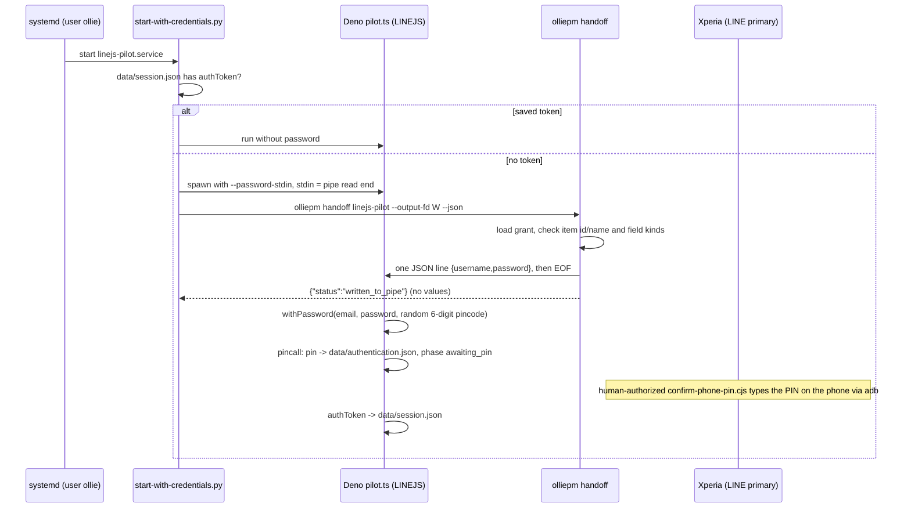

# LINE gateway password re-login through blindfill: evaluation

Status: evaluation only (2026-11-27). Nothing here is built; no code, service or setting was changed.
Claims marked **[observed]** were seen read-only on ollie-ubuntu on 2026-11-27 (file listings, code,
docs, permission listings; no file under `data/`, no token, session or secret value was read);
**[source]** come from the cited code or docs; **[inference]** were not verified.

## 1. Verdict

- On ollie-ubuntu, Ollie (the LLM agent), the `bw` agent API key, the LINE service and the LINE
  session token share Unix user `ollie`, which has `NOPASSWD: ALL` sudo (§5). Mics accepts this
  (2026-11-27). So every option here keeps the password away from the model and its logs by
  construction of the code path, not by an OS boundary; that is also true of today's olliepm path.
- **Recommended: (d)**, the LINE launcher reads the one item from Bitwarden itself with the agent
  API key, bound by item id, and pipes it to LINEJS; no blindfill and no LLM in the path. About
  1 agent day; retires olliepm for LINE; adds no secret-export path to blindfill; no weaker than
  today (§4.4).
- **Not recommended: (a)**, a blindfill "local process" actuator. On a shared uid its
  path/hash/uid binding is defeatable (§4.1), so it would cost 4-6 days and widen blindfill's
  promise without protecting anything (d) does not.
- **(b)** is not available: LINE has no login surface blindfill supports that yields a LINEJS session.
- **(c) QR login** needs no password on the host at all and is the strongest option, but adds a
  phone scan to every re-login; keep it as the fallback and let Mics choose (§6).
- Every password re-login already needs the phone: LINE asks for a PIN on the primary device
  (§2). The option choice changes where the password lives, not whether a person is involved.

## 2. The current olliepm path

### 2.1 Flow

- **Trigger [source]** (`systemd/linejs-pilot.service`, `start-with-credentials.py`): any start of
  `linejs-pilot.service` with no `authToken` in `data/session.json` requests the password at once.
  `Restart=on-failure`, `RestartPreventExitStatus=78`, at most 6 starts per 30 minutes. A password
  login, a failed handoff, a provider-rejected saved token, or a launcher crash without a usable
  token exits 78, so systemd never retries a password login; a person restarts it. The unit is
  `linked`, not enabled at boot (password-pipe doc 2026-10-20), and runs under lingering user
  `ollie` [observed: `Linger=yes`, unit active].
- **Grant [source]** (`ollie_password_management/handoff.py`): `~/.config/ollie-password-management/handoffs/linejs-pilot.json`
  must be a regular file, mode 0600, one link, owned by the caller uid, at most 16 KiB, exact
  schema. It pins item name **and** 32-hex item id, the fields (here `username`, `password`
  [observed]), `format=json`, a `purpose` and `destinations`
  (`https://legy.line-apps.com`, `https://gf.line.naver.jp` [observed]). Only `text`/`password`
  kinds; TOTP seeds refused. `purpose`/`destinations` are declarations; the code does not check
  them against the reader (olliepm `docs/credential-handoff.md` says so).
- **Pipe [source]**: the launcher makes `pipe2(O_NONBLOCK|O_CLOEXEC)`, sets the read end blocking,
  hands it to Deno as stdin, and passes only the write end to olliepm (`pass_fds`). olliepm dups
  the FD and requires: FIFO named `pipe:[n]` in `/proc/self/fd`, same uid, write-only,
  nonblocking, not aliased to fd 0-2. It reads every field first, writes one payload of at most
  `min(4096, PIPE_BUF)` bytes in one `write`, 2 s default deadline (`--timeout`; the launcher waits
  15 s for the process), no retry on partial write or full pipe. Values never in argv, env, files
  or stdout; errors are fixed codes.
- **Receiver [source]** (`credential-input.ts`, `current/sidecar/main.ts`): reads stdin to EOF,
  max 4096 bytes, strict UTF-8, JSON object with exactly `password,username`, both non-empty;
  zeroes its buffer; any failure is the single error `CredentialInputInvalid`. Deno permissions:
  read/write only `data/` (plus read of `openclaw.json`), net only to four LINE hosts and the
  bridge socket, env allowlist, `--cached-only --frozen` with a lockfile. A saved token wins over
  piped credentials (`credentials = null`).
- **PIN / phone step [source]**: LINEJS `withPassword` sends a client-generated random 6-digit
  pincode; LINE shows a confirmation on the primary device, and `pincall` writes the PIN to
  `data/authentication.json` with status `awaiting_pin`. `confirm-phone-pin.cjs` (run on a
  person's authorization) checks status `awaiting_pin` + `password_pipe`, that the Xperia
  QV720B4852 foreground is `secondarylogin.legacy.DesktopLoginActivity`, that the screen matches a
  saved screenshot (>= 97 % of sampled pixels), types the PIN as `adb shell input tap` over stdin,
  checks the confirm button turned green, taps it once, and never replays. The QR path
  (`--auth-only` without password, `render-qr.cjs`) also emits `pincall` when certificate
  verification fails [source: LINEJS `base/login/mod.ts: requestSQR`].
- **History [observed, docs]**: first real login 2026-10-20 (password pipe, PIN typed via adb,
  then token resume without password). Re-login 2026-11-19 used a separate `reauth-20261119/login-once.py`
  (same handoff, `--auth-only`, own data dir); its status says `LoginError`, but
  `docs/recovery-2026-11-19.md` records that the token was issued and the error came after
  authentication (transport `/enc` 404), fixed by a release change. So password re-login is rare
  (about monthly so far) and partly hand-run.

### 2.2 Security properties of today's path

| Property                                         | Holds?                                                                                                                           |
| ------------------------------------------------ | -------------------------------------------------------------------------------------------------------------------------------- |
| Password never in model context, argv, env, logs | yes, by construction of the launcher and olliepm [source]                                                                        |
| Only one item and two fields can leave the store | yes for this grant [source]; but any same-uid process can call olliepm or Secret Service directly                                |
| Reader of the pipe is authenticated              | **no**; the launcher is trusted to spawn the right reader, the grant says so itself [source]                                     |
| Network destinations enforced                    | by Deno `--allow-net`, not by olliepm [source]                                                                                   |
| No automatic password retry                      | yes, exit 78 [source]                                                                                                            |
| Isolation from Ollie (LLM agent with a shell)    | **no**: same uid `ollie`, NOPASSWD sudo; accepted by Mics (§5) [observed]                                                        |
| Store unlocked without a person                  | `pass-secret-service` runs as "fresh unattended store" [observed unit description]; [inference] unlocked for any `ollie` process |

## 3. What blindfill offers today

blindfill's invariant 1 is that no API returns a secret-class value; it only types into a sink whose
identity it observed: a web origin, or an Android package + signer (ARCHITECTURE §2, §3.2). There
is no local-process sink, and `MIGRATING-FROM-OLLIEPM.md` §3 row 13 keeps the pipe handoff out:
"a future, separately reviewed sink would be an Actuator, not a read API."

## 4. Options

### 4.1 (a) blindfill "local process" actuator

Design if built: new actuator kind `process`. The item opts in with a Text field such as
`blindfill.process=<absolute path>` plus `blindfill.process_sha256=<hash>`; blindfill itself
spawns that executable (never accepts a caller FD, so it knows who reads), with fixed argv and
env from the item or a root-owned profile, stdin = anonymous pipe, writes the JSON once, closes,
reports only the exit status. Checks before the secret read: path is absolute, not a symlink,
owned by root or the service user and not writable by the caller uid, SHA-256 matches, the
running uid matches; one shot per call; MCP tool or CLI-only (MCP would let the LLM trigger it).

- **Threat model**: protects against the model receiving the value and against sending it to an
  unlisted program, **only if the caller cannot change what the program does**. On the current
  host it cannot: the consumer is not one file but `deno` + `pilot.ts` -> `current/sidecar/*.ts` +
  the vendored LINEJS + `runtime/deno-cache`, all writable by `ollie` [observed: owned by `ollie`,
  `current` is a symlink into `releases/`]. Hashing one binary proves nothing about the script
  tree; hashing the tree is a release-pinning system. Same-uid `ptrace` of the Deno process
  (default Yama scope 1 allows a parent; `sudo` allows anything) reads the password from memory.
- **Work**: actuator, item contract, spawn/pin/hash code, refusal tests with fake consumers,
  docs, security review: **4-6 agent days**. Changes the product promise ("nothing returns a
  secret" becomes "nothing returns a secret to the caller; one opted-in sink is a local program").
- **Maintenance**: every LINE release changes the hash, so every deploy edits a vault item; the
  sink would be reused for other programs, which is exactly the export path blindfill avoided.

### 4.2 (b) A login surface blindfill already supports

- LINE has no general web chat client. Its web sign-in (`access.line.me`) is LINE Login, an OAuth
  provider for third-party sites; it does not yield a LINEJS/Talk session [inference, public LINE
  docs]. The LINE Chrome extension signs in with email + password + phone PIN, but its session is
  inside a `chrome-extension://` origin that blindfill does not support, and moving that session
  into LINEJS would mean extracting the extension's tokens, i.e. a bypass [inference].
- The LINE Android app on the Xperia is the primary device, not a secondary login target; blindfill
  Android fill cannot produce a desktop/LINEJS session [inference].
- **Verdict: not available.** Work: none. Do not pursue.

### 4.3 (c) QR login (no password at all)

LINEJS already supports it: `main.ts` with `--auth-only` and no stdin password runs
`withQrCode`, writes the QR URL to `data/authentication.json`, and `render-qr.cjs` renders a private
PNG valid for 5 minutes [source]. The primary phone scans it; LINE may then ask for a PIN
(the same `pincall` and `confirm-phone-pin.cjs` path) [source].

- **Threat model**: the best of all options; no password is stored on the host, so nothing to
  leak. The QR URL is a short-lived login capability and must stay out of model context, same as
  today's PIN.
- **Cost**: a phone scan per re-login. The Xperia must scan a QR shown elsewhere (camera) or read
  it from an image; whether LINE's scanner accepts an image pushed by adb, and whether automating
  that is acceptable, is unverified [inference]. Mics or Ollie is involved at each re-login.
- **Work**: launcher change to stop calling olliepm and exit 78 with "QR login needed", plus a
  runbook: **0.5 agent day**. Maintenance: none beyond today's PIN script.

### 4.4 (d) Launcher reads Bitwarden itself (Mics' proposal)

The launcher (not an LLM, not blindfill) runs `bw` with the agent API key from
`~/.config/bw-agent/env`, gets the item by **id**, checks its name and the presence of `login.username`
and `login.password`, builds the same one-line JSON and writes it into the existing Deno pipe.
Implementation notes:

- `bw get item <id>` with `BW_SESSION` only in the child env, `stdout` captured into the launcher's
  memory, never logged; `stderr` dropped; fixed error codes in `launcher-status.json`, as today.
  Separate `BITWARDENCLI_APPDATA_DIR` so the LINE path does not log out other `bw` users (`bwu`
  runs `bw logout` and re-logs in on every call [source: `~/.local/bin/bwu`]).
- Keep olliepm's guarantees in the launcher: item id + name pin, payload <= 4096, one write,
  no retry, exit 78.
- Unlock: `bwu` derives a session from the API key alone; how an API-key login unlocks this
  Vaultwarden account without a master password was not checked [inference; check `bw status`
  once, which prints no secret].
- **Threat model (now, same uid)**: equal to today. The API key file is readable by every `ollie`
  process; it reads every item the agent account can see, a wider scope than the olliepm grant,
  but Ollie can already use that same key through `bwu`. Gains: one store instead of two, olliepm
  retired for LINE, no new blindfill surface. Loss: no per-item grant file; the item id lives in
  the launcher.
- **Work: about 1 agent day** (launcher change, synthetic pipe test with a fake `bw`, one
  supervised real re-login with Ollie's consent, docs). Moving the LINE item into the vault is a
  Vault change and needs Ollie's/Mics' approval. Maintenance: low; `bw` CLI upgrades.

### 4.5 Comparison

| Option                  | Password on host     | Agent days | Ongoing cost                  |
| ----------------------- | -------------------- | ---------- | ----------------------------- |
| today (olliepm)         | yes (Secret Service) | 0          | second store                  |
| (a) process actuator    | yes (vault)          | 4-6        | hash per release, new surface |
| (b) web/app login       | n/a                  | none       | not available                 |
| (c) QR                  | **no**               | 0.5        | phone scan per re-login       |
| (d) launcher reads `bw` | yes (vault)          | 1          | low                           |

None of (a), (d) or today's path is isolated from Ollie on this host (§5); (c) has nothing to steal
except a 5-minute QR capability.

## 5. Host status and owner decision

**[observed]** `ollie` (uid 1000) is in groups `sudo`, `adm`, `lxd` and has `(ALL) NOPASSWD: ALL`;
`~/.config/bw-agent/env` (0600, owner `ollie`) holds `BW_CLIENTID`/`BW_CLIENTSECRET`, and
`~/.local/bin/bwu` turns it into an unlocked `bw`; OpenClaw, `linejs-pilot` and
`pass-secret-service` run as user services of `ollie`. So Ollie, which has a shell, can read any
password the agent account sees with `bwu get password`, and the LINE `data/session.json` token.
blindfill's "never returns a secret" holds for its own interfaces only; on this host it rests on
the agent not going around it. **Mics decided on 2026-11-27 to keep this as it is: no separate Unix
user for the key, blindfill or the LINE gateway, no sudo change** (recorded in `HANDOFF.md`, owner
decisions). Options above are judged under that premise. If isolation is revisited, the per-user
split is void while `ollie` keeps NOPASSWD sudo or `lxd`, and (d) would then move to its own user
with a LINE-only vault account rather than need (a).

## 6. Decisions for Mics

1. **Re-login method**: (d) password from the vault via the launcher (recommended, ~1 agent day),
   or (c) QR only (no password on the host, phone scan each time, ~0.5 day). "LINE goes through
   blindfill" read literally is (a); this document recommends against it.
2. **Moving the LINE item into the Vault** (from olliepm's Secret Service): a Vault change; which
   collection, and Ollie's consent.
3. **One supervised real re-login** to verify (d) or (c): it logs the LINE gateway out and back in,
   so it needs a time window and someone at the Xperia for the PIN.
